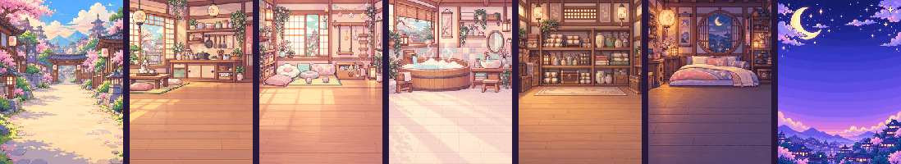

<div align="center">

# AniESP32

**A pocket ninja-pet for the ESP32 Cheap Yellow Display.**
Hatch it, feed it, train it, watch it evolve. All on a 2.8" touchscreen, in soft banded-gradient pixel art.


-yellow)


</div>

---

## What is it?

AniESP32 is a Tamagotchi-style virtual pet with a ninja village theme, written for the
**ESP32-2432S028 "Cheap Yellow Display" (CYD)**. It runs standalone: no phone, no server, no app.
Everything (sprites, backgrounds, fonts, game logic) lives on the board.

- A pet that **hatches, grows and evolves** into one of **8 adult forms**, depending on how you raise it
- Real **care mechanics**: hunger, mood, energy, poop, sickness, tantrums, bedtime
- A **main menu of round badge buttons** and cosy **room screens** where the pet wanders around
- **Shop, bag, DEX album, mini-games and timed missions**
- A **pixel-art digital clock** with optional NTP sync and an alarm
- **Day/night awareness** from the clock and the board's light sensor: it sleeps when the lights go out
- Polished UI: banded-gradient panels, outlined pixel fonts, fades through black between screens

## Gallery

<div align="center">



*Village, kitchen, playroom, bathroom, storage room, bedroom and the night clock.*

<br>


</div>

## Quick start

You need a CYD (see [which variant you have](docs/hardware.md#which-cyd-variant-do-you-have)), a USB cable and
[PlatformIO](https://platformio.org/install).

```bash
git clone <this repo> AniESP32 && cd AniESP32
pio run -t upload          # builds and flashes the ST7789 board (the default)
pio device monitor         # optional serial log
```

| Your board | Command |
|------------|---------|
| ST7789 CYD (micro USB **and** USB-C) | `pio run -t upload` |
| Original ILI9341 CYD (micro USB only) | `pio run -e cyd -t upload` |
| Test everything quickly (life cycle 60x faster) | `pio run -e cyd-fast -t upload` |

Wi-Fi is optional; set `WIFI_SSID`, `WIFI_PASS` and `TZ_POSIX` in [`include/config.h`](include/config.h) to sync the
clock over NTP. Full instructions: [Build and flash](docs/build-and-flash.md).

## How to play

1. **Tap the egg** to warm it. It hatches after 10 taps or 2 minutes.
2. Use the **bottom bar**: `HOME` (the pet in its village), `MENU` (all actions), `CLOCK`.
3. From the **menu** open a room. Each room has icons at the bottom right and a back icon at the top left.

| Room | What you do there |
|------|-------------------|
| **Feed** | Free rice, or onigiri, ramen and dango from your bag |
| **Play** | Quick play, **shuriken** and **shell** mini-games, **missions** |
| **Clean** | Sweep up poop, use medicine when it is sick |
| **Bag** | Medicine, chakra potions and training scrolls |
| **Sleep** | Put it to bed or wake it up |
| **Shop / DEX** | Spend ryo, see which forms you have raised |
| **Clock** (bottom bar) | Set the time and the alarm |

Keep the three bars (food, joy, energy) up, clean up the poop, answer its calls, and tap it to scold a tantrum.
Fewer care mistakes and higher discipline lead to the rarer forms. The full rules are in [Gameplay](docs/gameplay.md).

## Hardware at a glance

| | |
|---|---|
| Board | ESP32-2432S028 ("CYD"), ESP32-WROOM-32, 4 MB flash |
| Display | 2.8" 240x320 TFT, **ST7789** (or ILI9341 on the older variant), SPI on HSPI |
| Touch | XPT2046 resistive, own SPI bus |
| Extras used | RGB LED, speaker (amp on GPIO 26), light sensor (GPIO 34), PWM backlight (GPIO 21) |

Everything you need to reuse the board and display setup in your own project, with copy-paste configs, is in
[Board and display configuration](docs/display-and-touch.md) and [Hardware](docs/hardware.md).

## Documentation

| Doc | Contents |
|-----|----------|
| [Hardware](docs/hardware.md) | Board, variants, full pinout, peripherals, flash layout |
| [Display and touch configuration](docs/display-and-touch.md) | **Reusable** TFT_eSPI + touch setup, tuning, a minimal test sketch |
| [Build and flash](docs/build-and-flash.md) | Toolchain, environments, `config.h` options, debug builds |
| [Gameplay](docs/gameplay.md) | Every rule and number: life cycle, care, evolution, economy, games |
| [Architecture](docs/architecture.md) | Modules, screens, rendering, save data, main loop |
| [Assets](docs/assets.md) | Art pipeline, sheet formats, regenerating sprites and fonts |
| [Extending](docs/extending.md) | Add a form, room, item, screen; tune balance |
| [Troubleshooting](docs/troubleshooting.md) | Colors, touch, upload and memory problems |

## Project layout

```
src/                firmware: pet logic, screens, graphics, hardware
include/config.h    Wi-Fi, timezone, light sensor, tone curve
tools/              make_assets.py, make_font.py and the font sources
assets/v2/raw/      source art sheets and backgrounds
docs/               documentation
platformio.ini      build environments and the display/board flags
```

## Status and honesty

This is a hobby project built and tuned on one CYD (the ST7789 variant). The balance numbers (decay rates,
timings, prices) are a first pass and live in a few constants, see [Extending](docs/extending.md). The ILI9341
environment is kept for the original board but was not the one used for final testing.

## Credits and licensing

- Fonts: **Silkscreen** and **Press Start 2P**, SIL Open Font License 1.1 ([notice](tools/fonts/README.md)).
- Libraries: [TFT_eSPI](https://github.com/Bodmer/TFT_eSPI), [XPT2046_Touchscreen](https://github.com/PaulStoffregen/XPT2046_Touchscreen).
- Board knowledge from the excellent [ESP32-Cheap-Yellow-Display](https://github.com/witnessmenow/ESP32-Cheap-Yellow-Display) community repo.
- Art sources were generated with an image model and processed by `tools/make_assets.py`; check that the terms of the
  tool you use fit how you intend to share them.
- No license has been chosen for the code yet; add a `LICENSE` file before publishing.
