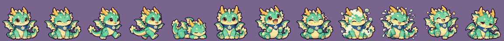
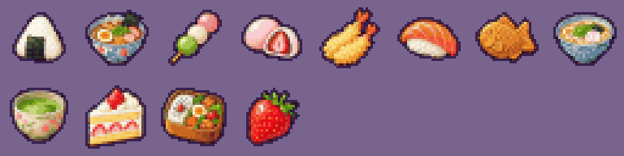

<div align="center">

# AniESP32

**A pocket ninja-pet for the ESP32 Cheap Yellow Display.**
Hatch it, feed it, wash it, train it, and watch it grow into one of 22 animated forms.
All on a 2.8" touchscreen, in soft banded-gradient pixel art, with no phone and no server.


-yellow)


</div>

---

## Contents

[What is it?](#what-is-it) ·
[Meet the pets](#meet-the-pets) ·
[Screens](#screens) ·
[Quick start](#quick-start) ·
[How to play](#how-to-play) ·
[Hardware](#hardware-at-a-glance) ·
[Documentation](#documentation) ·
[Project layout](#project-layout) ·
[Status](#status-and-honesty) ·
[Credits](#credits-and-licensing)

## What is it?

AniESP32 is a Tamagotchi-style virtual pet with a ninja village theme for the
**ESP32-2432S028 "Cheap Yellow Display" (CYD)**. Everything (sprites, backgrounds, fonts, game logic, save data) lives
on the board.

- **A real life cycle:** egg, baby, child, teen, then an adult form chosen by how you raised it
- **22 adult forms**, each with a hint in the DEX, from a Kitsune to a Jade Dragon
- **Fully animated pets:** idle, walking, sitting, sleeping, eating, being washed, happy and sad, for all 25 characters
- **Real care mechanics:** hunger, mood, energy, poop, sickness, tantrums and bedtime, with a **stats screen** that tells
  you what to do next and a seven-page **help** screen
- **Rooms to explore:** feed, play, clean, bag and sleep, each with its own scene where the pet wanders around
- **A shop with 15 items** (12 foods, potion, medicine, scroll) in paged cards, a bag, mini-games and timed missions
- **A pixel-art clock** with optional NTP sync and an alarm
- **Day and night:** the pet follows the clock and the board's light sensor, and the screen dims when it is late
- **Polished UI:** banded-gradient panels, outlined pixel fonts, fades through black between screens

## Meet the pets

Every pet starts as the same tiny fox and grows up through baby, child and teen. At the end of the teen stage it
**evolves**, and which of the 22 forms you get depends on your care mistakes, discipline, bond, joy, energy and food.
Rules and hints: [Gameplay](docs/gameplay.md#evolution).

<div align="center">

<br>
<sub>One pet, twelve frames: idle, blink, two walk frames, sleep, sit, two eat frames, two wash frames, happy, sad.</sub>

</div>

## Screens

| Screen | What it does |
|--------|--------------|
| **Home** | Your pet in its village. Stat bars on top, a status label for whatever is wrong, tap it to pet it |
| **Menu** | A 3x3 grid of round badges: Feed, Play, Clean, Bag, Sleep, Shop, DEX, Stats, Help |
| **Rooms** | Feed, play, clean, bag and sleep rooms. A small pet roams around, icons sit at the bottom right |
| **Shop** | FOOD and ITEMS tabs, four large cards per page with BACK / NEXT, effects shown as icons |
| **DEX** | The 22 forms, six per page. Locked forms are silhouettes with an evolution hint |
| **Stats** | Every stat with a level word, care indicators and a "what to do" list |
| **Help** | How to play, the stats, fixing problems, evolution, games, shop, day and night |
| **Clock** | Date, big steady time, seconds bar, alarm and sync status, compact buttons |
| **Mini-games** | Shuriken timing and the shadow-clone shell game, in a dojo |

The bottom bar is **HOME**, **MENU** and **CLOCK**; every other page has a round back arrow at the top left.

<div align="center">

<br>
<sub>Village, kitchen, playroom, bathroom, storage room, bedroom and the night clock.</sub><br><br>



</div>

## Quick start

You need a CYD (see [which variant you have](docs/hardware.md#which-cyd-variant-do-you-have)), a USB cable and
[PlatformIO](https://platformio.org/install).

```bash
git clone https://github.com/mirimomekiku/AniESP32.git && cd AniESP32
pio run -t upload          # builds and flashes the ST7789 board (the default)
pio device monitor         # optional serial log
```

| Your board | Command |
|------------|---------|
| ST7789 CYD (micro USB **and** USB-C) | `pio run -t upload` |
| Original ILI9341 CYD (micro USB only) | `pio run -e cyd -t upload` |
| Test everything quickly (life cycle 60x faster) | `pio run -e cyd-fast -t upload` |

Wi-Fi is optional: set `WIFI_SSID`, `WIFI_PASS` and `TZ_POSIX` in [`include/config.h`](include/config.h) to sync the clock
over NTP. The first build downloads several GB of toolchains and takes a while. Full instructions:
[Build and flash](docs/build-and-flash.md).

## How to play

1. **Tap the egg** to warm it. It hatches after 10 taps or 2 minutes.
2. Open the **MENU** and pick a room. In a room, tap the round icons at the bottom right to act, and the arrow at the
   top left to go back.
3. Watch the **status labels** under the stat bars and open **Stats** whenever you are unsure what to do.

| Problem | What to do |
|---------|-----------|
| `HUNGRY!` | **Feed** it: rice is free, or any food you own |
| `UNHAPPY!` / `VERY SAD!` | **Play**, or give a treat such as dango or cake |
| `SLEEPY!` | **Sleep** room |
| `TOO DIRTY!` | **Clean** room |
| `FEELS ILL` | Give **medicine** (buy it in the shop) within 90 minutes |
| `GRUMPY!` | Tap the pet to scold it |

Answer calls within 15 minutes to avoid care mistakes. Fewer mistakes and higher discipline lead to the rarer forms.
The in-game **Help** screen covers all of this, and the full rules are in [Gameplay](docs/gameplay.md).

## Hardware at a glance

| | |
|---|---|
| Board | ESP32-2432S028 ("CYD"), ESP32-WROOM-32, 4 MB flash, no PSRAM |
| Display | 2.8" 240x320 TFT, **ST7789** (or ILI9341 on the older variant), SPI on HSPI |
| Touch | XPT2046 resistive, its own SPI bus |
| Extras used | RGB LED, speaker (amp on GPIO 26), light sensor (GPIO 34), PWM backlight (GPIO 21) |
| Flash | custom 3.9 MB app partition; the save data lives in NVS and survives re-flashing |

Everything you need to reuse the board and display setup in your own project, with copy-paste configs and a tested
example, is in [Display and touch configuration](docs/display-and-touch.md) and [Hardware](docs/hardware.md).

## Documentation

| Doc | Contents |
|-----|----------|
| [Hardware](docs/hardware.md) | Board, variants, full pinout, peripherals, flash layout |
| [Display and touch configuration](docs/display-and-touch.md) | **Reusable** TFT_eSPI + touch setup, tuning, a minimal test sketch |
| [Build and flash](docs/build-and-flash.md) | Toolchain, environments, `config.h` options, debug builds |
| [Gameplay](docs/gameplay.md) | Every rule and number: life cycle, care, evolution table, economy, games |
| [Architecture](docs/architecture.md) | Modules, screens, rendering, save data, main loop |
| [Assets](docs/assets.md) | Art pipeline, sheet formats, regenerating sprites and fonts |
| [Extending](docs/extending.md) | Add a form, room, item, screen or help page; tune balance |
| [Troubleshooting](docs/troubleshooting.md) | Colors, touch, upload and memory problems |

## Project layout

```
src/                firmware: pet logic, screens, graphics, hardware
include/config.h    Wi-Fi, timezone, light sensor, tone curve
partitions.csv      flash layout (3.9 MB app, NVS at the usual address)
tools/              make_assets.py, make_font.py and the font sources
assets/             source art: v2 (UI, items, backgrounds), v3 and v4 (pets, foods, icons)
docs/               documentation and a reusable display/touch example project
platformio.ini      build environments and the display/board flags
```

## Status and honesty

This is a hobby project built and tuned on one CYD (the ST7789 variant). The balance numbers (decay rates, timings,
prices, evolution thresholds) are a first pass and live in a few constants, see [Extending](docs/extending.md). The
ILI9341 environment is kept for the original board but was not the one used for final testing. All early stages share
the fox line; only the adult forms differ.

## Credits and licensing

- Fonts: **Silkscreen** and **Press Start 2P**, SIL Open Font License 1.1 ([notice](tools/fonts/README.md)).
- Libraries: [TFT_eSPI](https://github.com/Bodmer/TFT_eSPI), [XPT2046_Touchscreen](https://github.com/PaulStoffregen/XPT2046_Touchscreen).
- Board knowledge from the excellent [ESP32-Cheap-Yellow-Display](https://github.com/witnessmenow/ESP32-Cheap-Yellow-Display) community repo.
- Art sources were generated with an image model and processed by `tools/make_assets.py`; check that the terms of the
  tool you use fit how you intend to share them.
- No license has been chosen for the code yet; add a `LICENSE` file before publishing.
